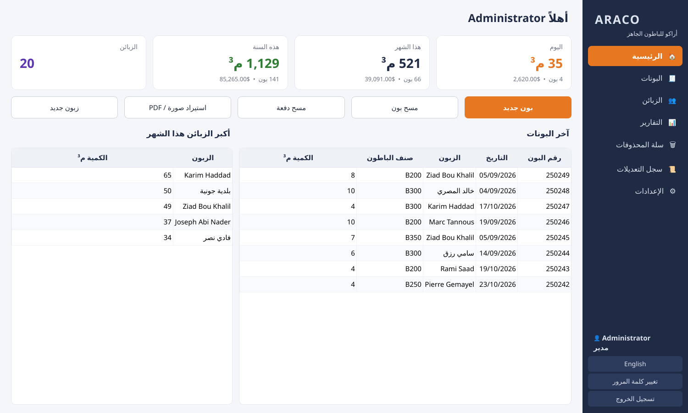
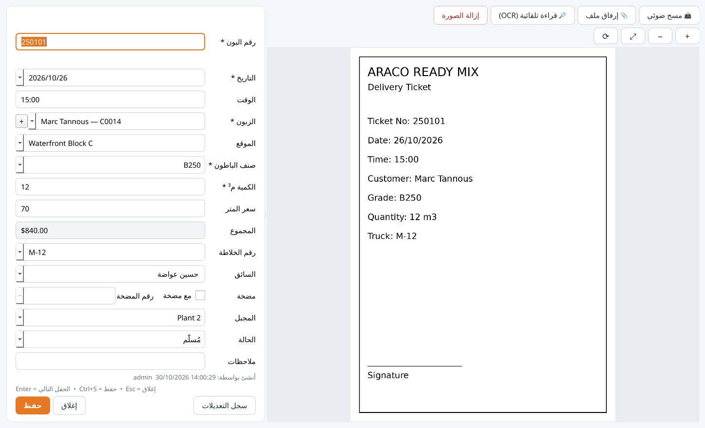
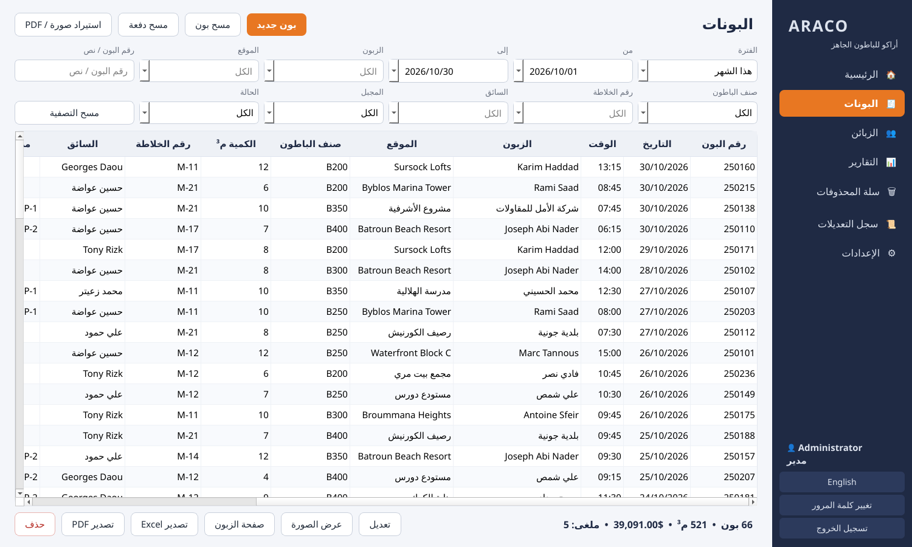
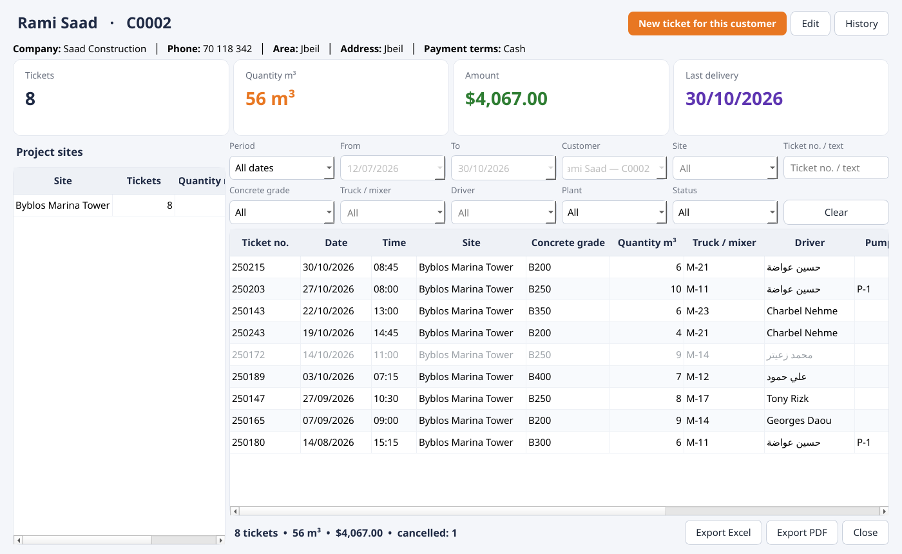
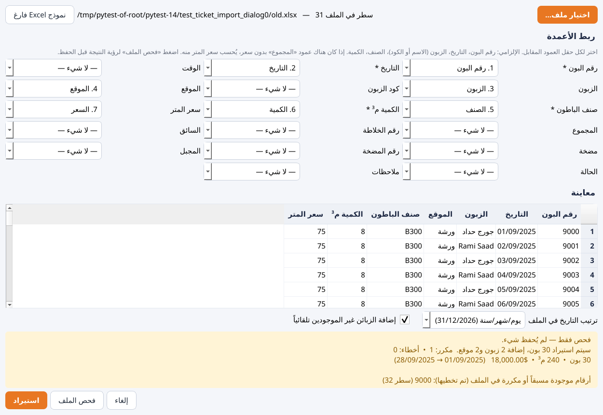

<div dir="rtl">

# أراكو للباطون الجاهز — برنامج الزبائن والبونات

برنامج مكتبي يعمل على Windows لإدارة **الزبائن** و**بونات التسليم** مع **المسح الضوئي** و**التقارير**.
كل البيانات محفوظة على هذا الكمبيوتر فقط، ولا يحتاج البرنامج إلى إنترنت.

---

## 1. التثبيت والتشغيل

1. انسخ الملف `ARACO_Bons.exe` إلى أي مكان، مثلاً سطح المكتب أو `C:\ARACO`.
2. شغّله بالضغط المزدوج. إذا ظهرت رسالة Windows SmartScreen اضغط **More info ← Run anyway**.
3. سجّل الدخول:

| المستخدم | كلمة المرور | الصلاحية |
|---|---|---|
| `admin` | `admin123` | مدير: كل شيء + الإعدادات + الحذف |
| `entry` | `entry123` | إدخال بيانات: إضافة وتعديل فقط |

> ⚠️ **غيّر كلمتي المرور فوراً**: من زر «تغيير كلمة المرور» أسفل القائمة، أو من **الإعدادات ← المستخدمون**.

4. عند أول دخول للمدير يعرض البرنامج تحميل **بيانات تجريبية** (20 زبون و150 بون) للتجربة.
   لمسحها قبل بدء العمل الحقيقي: **الإعدادات ← النسخ الاحتياطي ← مسح كل الزبائن والبونات** واكتب `WIPE`.
5. زر **English / عربي** في أسفل القائمة يبدّل لغة الواجهة.

### مجلد البيانات
كل شيء محفوظ في `C:\ARACO_Data\`:

```
C:\ARACO_Data\
├── database.db          قاعدة البيانات (الزبائن، البونات، المستخدمون، السجل)
├── scans\2026\10\       صور وملفات PDF للبونات حسب السنة والشهر
└── backups\             النسخ الاحتياطية التلقائية واليدوية
```

---

## 2. تثبيت Tesseract للقراءة التلقائية (OCR) — اختياري

القراءة التلقائية تقرأ نموذج **Delivery Journal** وتقترح: **رقم البون (Voucher)، التاريخ، الوقت، الزبون، الموقع (Project Name)، الصنف (مثل B25)، الكمية م³، رقم الخلاطة، السائق، والمضخة**. تُطابَق الأسماء تلقائياً مع الزبائن والسائقين الموجودين حتى لو أخطأت القراءة بحرف. وإذا كان الزبون جديداً يعرض البرنامج إضافته مع عنوانه من البون. تستغرق القراءة حوالي 5–8 ثوانٍ. تظهر الحقول المعبّأة باللون الأصفر،
ويجب مراجعتها قبل الحفظ.

1. نزّل برنامج التثبيت من: <https://github.com/UB-Mannheim/tesseract/wiki>
   (الملف `tesseract-ocr-w64-setup-….exe`).
2. أثناء التثبيت، في صفحة **Choose Components** افتح **Additional language data (download)**
   وحدّد **Arabic**. الإنكليزية مثبتة تلقائياً.
3. اترك مسار التثبيت الافتراضي: `C:\Program Files\Tesseract-OCR\`.
4. في البرنامج: **الإعدادات ← الماسح و OCR** ثم اضغط **اختبار**. يجب أن يظهر:
   `✔ Tesseract موجود … اللغات: ara, eng`.
   إذا ثبّتّه في مكان آخر فاضغط **استعراض…** واختر `tesseract.exe`.
5. يمكن تشغيل القراءة أو إيقافها من نفس الصفحة، ويمكن أيضاً تشغيلها تلقائياً بعد كل مسح.

> إذا لم يتم تثبيت Arabic، يعمل البرنامج بالإنكليزية فقط (eng).

---

## 3. توصيل الماسح الضوئي

يستخدم البرنامج **WIA**، وهي طريقة Windows القياسية للماسحات.

1. ثبّت **برنامج التعريف (Driver)** الخاص بالماسح من موقع الشركة المصنعة (HP / Canon / Epson / Brother…).
2. تأكد أن الماسح يعمل في Windows: افتح **Windows Fax and Scan** أو تطبيق **Scan** وجرّب المسح.
3. في البرنامج: **البونات ← مسح بون** (أو اضغط **F2** داخل نافذة البون).
   في أول مرة اختر الماسح من القائمة.
4. من **الإعدادات ← الماسح و OCR**:
   - **الدقة 200 DPI** كافية ومناسبة لـ OCR. استعمل 300 إذا كانت الكتابة صغيرة.
   - **مسح بالألوان** أو بالرمادي، والرمادي يعطي ملفات أصغر.
   - **إظهار نافذة الماسح**: فعّلها إذا لم يعمل المسح المباشر مع جهازك.

**الماسحات بدون WIA (TWAIN فقط):** امسح البونات ببرنامج الماسح واحفظها في مجلد، ثم استعمل
**مسح دفعة ← من ملفات** أو **استيراد صورة / PDF**. وهذه أيضاً الطريقة لصور الهاتف (WhatsApp مثلاً).

---

## 4. إدخال البونات

- **بون جديد**: نافذة فيها الصورة على جانب والحقول على الجانب الآخر.
- **Enter** ينقلك للحقل التالي، و**Enter** في آخر حقل يحفظ.
- يكمل البرنامج تلقائياً الزبون والموقع ورقم الخلاطة والسائق والمضخة أثناء الكتابة.
  البحث يتجاهل اختلاف أ/إ/ا و ة/ه و ى/ي.
- كتابة اسم موقع جديد تضيفه للزبون تلقائياً. كتابة زبون غير موجود تعرض إضافته.
- **سعر المتر** يُقترح من آخر بون لنفس الزبون ونفس الصنف، و**المجموع** يُحسب تلقائياً.
- يظهر تحذير أحمر فوراً إذا كان **رقم البون موجوداً مسبقاً**، ولا يمكن حفظ رقم مكرر.
- **حفظ والتالي** يحفظ ويفتح بوناً جديداً مع الاحتفاظ بالتاريخ والمجبل.

| الاختصار | العمل |
|---|---|
| Enter | الحقل التالي / حفظ في آخر حقل |
| Ctrl+S | حفظ |
| F2 | مسح ضوئي |
| F3 | قراءة OCR |
| Esc | إغلاق |
| Ctrl+N | بون جديد (من أي صفحة) |
| Ctrl+1 … Ctrl+7 | التنقل بين الصفحات |

### مسح دفعة (عدة بونات متتالية)
**البونات ← مسح دفعة**، ثم اختر:
- **من الماسح**: ضع البون واضغط مسح. بعد «حفظ والتالي» يمسح البرنامج البون التالي تلقائياً،
  وهذا مناسب لماسحات وحدة التغذية (ADF).
- **من ملفات**: اختر كل الصور أو ملفات PDF مرة واحدة، فيعرض البرنامج كل ملف مع نموذج فارغ.
  زر **تخطي** يتجاوز صورة.

الصورة تُحفظ في `scans\السنة\الشهر\` وترتبط بالبون. اضغط **عرض الصورة** للتكبير والتدوير.

---

## 5. الزبائن

- البحث بالاسم أو الهاتف أو الكود أو المنطقة. الكود (C0001 …) يُعطى تلقائياً.
- لكل زبون عدة **مواقع / ورش**.
- **صفحة الزبون** (ضغط مزدوج) تعرض كل بوناته مع المجموع (عدد، م³، مبلغ) حسب الفترة والموقع،
  مع تصدير Excel و PDF.
- **استيراد من Excel/CSV** (للمدير): اختر الملف، ويقترح البرنامج ربط الأعمدة تلقائياً من العناوين
  بالعربية أو الإنكليزية. صحّح الربط عند الحاجة، ثم اضغط **استيراد**.
  الأسطر المتكررة لنفس الزبون تُدمج ومواقعها تُضاف. ملفات `.xls` القديمة احفظها أولاً بصيغة `.xlsx`.

### استيراد البونات القديمة من Excel/CSV (للمدير)
**البونات ← استيراد بونات قديمة**:
1. اضغط **نموذج Excel فارغ** إذا أردت ملفاً جاهزاً بالأعمدة الصحيحة، أو استعمل ملفك القديم كما هو.
2. **اختيار ملف…**، ثم يربط البرنامج الأعمدة تلقائياً من العناوين بالعربية أو الإنكليزية.
   صحّح الربط عند الحاجة. الحقول الإلزامية: رقم البون، التاريخ، الزبون (الاسم أو الكود)، الصنف، الكمية.
3. اختر **ترتيب التاريخ** (يوم/شهر/سنة هو الافتراضي في لبنان). تواريخ Excel الحقيقية تُقرأ تلقائياً.
4. اضغط **فحص الملف**: يعرض عدد البونات التي ستُستورد، والزبائن والمواقع الجديدة، والمجموع م³ والمبلغ،
   والأرقام المكررة، والأسطر الخاطئة مع رقم السطر. **لا يُحفظ شيء في هذه المرحلة.**
5. صحّح الملف إذا لزم، ثم اضغط **استيراد**.

ملاحظات:
- الزبون يُطابَق بالكود ثم بالاسم، مع تجاهل اختلاف أ/ا و ة/ه. الزبائن غير الموجودين يُضافون تلقائياً،
  ويمكن إلغاء هذا الخيار. المواقع الجديدة تُضاف للزبون.
- **الأرقام المكررة** (موجودة في البرنامج أو متكررة في الملف) لا تُستورد، وتظهر في التقرير.
- إذا كان في الملف **المجموع** بدون سعر، يُحسب سعر المتر منه، ويُحفظ المبلغ القديم كما هو.
- «ملغى» أو «cancelled» في عمود الحالة يجعل البون ملغى. «نعم» أو رقم في عمود المضخة يعني أن المضخة استُعملت.
- الأصناف تُوحَّد، فتصبح `b 300` و `300` بالشكل `B300`.
- كل الاستيراد يتم دفعة واحدة. إذا حدث خطأ غير متوقع لا يُحفظ أي شيء.

---

## 6. التقارير

**التقارير**: اختر **التجميع حسب** (الزبون، اليوم، الشهر، صنف الباطون، الخلاطة، السائق، المجبل،
الموقع، السنة)، ثم صفِّ حسب الفترة أو الزبون أو أي حقل آخر. النتيجة: العدد، الكمية م³، المبلغ،
ومعدل السعر. يمكن تصدير أي جدول إلى **Excel** أو **PDF**.

> البونات **الملغاة** لا تدخل في المجاميع، لكنها تظهر في البحث باللون الرمادي.

---

## 7. النسخ الاحتياطي والاسترجاع

**تلقائياً:** عند كل تشغيل، وكل ساعة إذا بقي البرنامج مفتوحاً، تُؤخذ نسخة يومية من قاعدة البيانات
في `C:\ARACO_Data\backups\auto_YYYY-MM-DD.db`، ويُحتفظ بآخر **30** نسخة.

**يدوياً** (المدير): **الإعدادات ← النسخ الاحتياطي**
- **نسخة احتياطية الآن**: نسخة من قاعدة البيانات في مجلد backups.
- **نسخة كاملة (قاعدة البيانات + الصور) إلى…**: ملف ZIP واحد. **احفظه على فلاشة أو قرص خارجي
  أسبوعياً**، لأن النسخ داخل نفس الكمبيوتر لا تحمي من تعطل القرص.

**الاسترجاع:** **استرجاع من نسخة…** واختر ملف `.db` أو `.zip`. قبل الاسترجاع يحفظ البرنامج الوضع الحالي
تلقائياً باسم `prerestore_….db`، فيمكن التراجع إذا اخترت نسخة خاطئة.

**نقل البرنامج إلى كمبيوتر جديد:** انسخ مجلد `C:\ARACO_Data` بالكامل والملف `ARACO_Bons.exe`
إلى الكمبيوتر الجديد في نفس المكان. أو ثبّت البرنامج ثم استرجع ملف ZIP الكامل.

---

## 8. الصلاحيات، السجل، وسلة المحذوفات

- **إدخال بيانات**: إضافة وتعديل الزبائن والبونات، والمسح، والبحث، والتقارير.
- **مدير**: كل ما سبق، بالإضافة إلى الحذف، وسلة المحذوفات، والاستيراد، والإعدادات، والمستخدمون،
  والنسخ الاحتياطي، وسجل التعديلات.
- **الحذف** يطلب تأكيداً، ويضع السجل في **سلة المحذوفات** حيث يمكن **استرجاعه** أو حذفه نهائياً.
- **سجل التعديلات** يسجّل من أنشأ أو عدّل كل سجل ومتى، مع القيمة القديمة والجديدة.
  زر **سجل التعديلات** موجود أيضاً داخل نافذة البون والزبون.
- **الإعدادات ← القوائم**: أصناف الباطون (B200، B250…) والمجابل والخلاطات والسائقون.

---

## 9. حل المشاكل

| المشكلة | الحل |
|---|---|
| «لم يتم العثور على ماسح ضوئي» | تأكد من التوصيل والتشغيل والـ Driver، وجرّب «إظهار نافذة الماسح» |
| «Tesseract غير مثبت» | راجع القسم 2، أو حدّد المسار في الإعدادات |
| القراءة التلقائية غير دقيقة | امسح بدقة 300 DPI، وتأكد أن البون مستقيم وواضح |
| خطأ غير متوقع | التفاصيل في `C:\ARACO_Data\error.log`، أرسله للدعم |
| نسيت كلمة مرور المدير | مستخدم مدير آخر يعيّنها من الإعدادات ← المستخدمون |

</div>

---

## For developers (English)

- Python 3.11+, PySide6, SQLite. Structure and DB schema: [`docs/ARCHITECTURE.md`](docs/ARCHITECTURE.md).
- Run from source: `pip install -r requirements-dev.txt` then `python main.py`
  (`--data-dir D:\test` uses another data folder; `--seed` loads sample data and exits).
- Tests: `QT_QPA_PLATFORM=offscreen python -m pytest -q tests` (services, import/export, backup, OCR, every
  screen in both languages, keyboard entry flow, batch mode).
- Build the .exe on Windows: `build.bat` → `dist\ARACO_Bons.exe`. CI (`.github/workflows/bons-desktop.yml`)
  builds it on `windows-latest`, runs `ARACO_Bons.exe --selftest` and uploads it as the `ARACO_Bons-windows`
  artifact.

### Screenshots

| | |
|---|---|
|  |  |
|  |  |
|  | |
